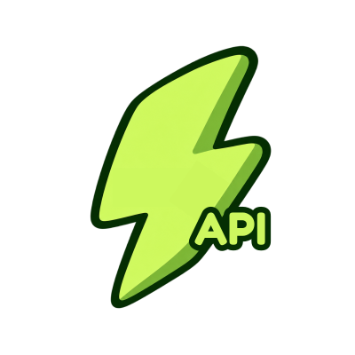

<p align="center">
  
</p>

# @zapwebp/api

High-performance, transparency-safe HTTP REST API for image conversion, metadata inspection, and asset optimization. Built with Express, fully documented via OpenAPI 3.1, and powered by the memory-only `@zapwebp/core` engine.

Production service: [https://zapwebp.vercel.app/api](https://zapwebp.vercel.app/api)  
OpenAPI 3.1 Specification: `/openapi/openapi.json`

---

## Features

- **Transparency-Preserving Conversion:** Preserves alpha channels across SVG, PNG, WebP, and AVIF. Transparent inputs to JPEG without an explicit background throw structured `alpha_not_representable` errors.
- **Zero Disk I/O & Memory-Only Execution:** All uploads are held in memory (`multer.memoryStorage()`) and processed with libvips (`sharp`) and Rust SVG (`@resvg/resvg-js`). Nothing is ever written to disk or logged remotely.
- **Strict SVG Sandboxing:** SVGs containing active scripts (`<script>`, inline `on*` event handlers) or XXE entity declarations (`<!ENTITY>`) are rejected immediately with HTTP 400.
- **Single & Batch Endpoints:** Convert individual assets or multipart file batches with concurrency limits.
- **Dual MCP Transport:** Mounts `/mcp` providing Streamable HTTP / Server-Sent Events (SSE) for remote AI agents and chatbots.

---

## Installation

```bash
pnpm add @zapwebp/api
```

---

## Server Mounting & Usage

```javascript
const express = require('express');
const { createApiRouter } = require('@zapwebp/api');

const app = express();
app.use(express.json());

// Mount the API router
app.use('/api/v1', createApiRouter({
  maxFileBytes: 5 * 1024 * 1024,
  maxBatchBytes: 20 * 1024 * 1024,
  maxWidth: 4096,
}));

app.listen(3000, () => {
  console.log('Zapwebp API running on port 3000');
});
```

---

## REST Endpoints Reference

### 1. Health Check

```http
GET /health
```

Verifies server readiness and returns supported format arrays.

#### Response (200 OK)
```json
{
  "status": "ok",
  "version": "1.1.0",
  "formats": {
    "input": ["svg", "png", "jpeg", "webp", "avif", "gif", "tiff"],
    "output": ["webp", "png", "jpeg", "avif"]
  }
}
```

---

### 2. Inspect Image

```http
POST /api/v1/inspect
Content-Type: multipart/form-data
```

Inspects an image's metadata, dimensions, color channels, and transparency without performing a conversion.

#### Parameters
| Parameter | Type | Required | Description |
|---|---|---|---|
| `file` or `svg` | File | Yes | Image asset to inspect |

#### cURL Example
```bash
curl -F "file=@logo.png" https://zapwebp.vercel.app/api/v1/inspect
```

#### Response (200 OK)
```json
{
  "format": "png",
  "width": 800,
  "height": 600,
  "hasAlpha": true,
  "channels": 4,
  "space": "srgb",
  "bytes": 45210,
  "aiProvenanceHints": []
}
```

---

### 3. Convert Image

```http
POST /api/v1/convert
Content-Type: multipart/form-data
```

Converts a single image with strict alpha channel safety.

#### Parameters
| Field | Type | Default | Description |
|---|---|---|---|
| `file` or `svg` | File | Required | Source image asset |
| `to` | string | `webp` | Target format: `webp`, `png`, `jpeg`, `avif` |
| `width` | number | source | Constrain max width (pixels) |
| `height` | number | source | Constrain max height (pixels) |
| `fit` | string | `contain` | Resize strategy: `contain`, `cover`, `fill`, `inside`, `outside` |
| `quality` | number | `85` | Compression quality rating (1–100) |
| `lossless` | boolean | `false` | Enable lossless encoding (WebP/AVIF/PNG) |
| `background` | string | none | Background hex color (e.g. `#ffffff`). **Required** if source has alpha and target is `jpeg`. |
| `clean` | boolean | `true` | Strip EXIF, XMP, C2PA, and metadata chunks |

#### Response Headers
| Header | Description |
|---|---|
| `Content-Type` | Target MIME type (`image/webp`, `image/png`, etc.) |
| `X-Zapwebp-Width` | Output image width in pixels |
| `X-Zapwebp-Height` | Output image height in pixels |
| `X-Zapwebp-Alpha-Preserved` | `true` if transparent alpha channel was preserved |

#### cURL Examples
```bash
# Convert SVG to WebP preserving transparency
curl -F "svg=@icon.svg" -F "to=webp" -F "width=512" \
  https://zapwebp.vercel.app/api/v1/convert -o icon.webp

# Convert transparent PNG to JPEG with explicit white background
curl -F "file=@badge.png" -F "to=jpeg" -F "background=#ffffff" \
  https://zapwebp.vercel.app/api/v1/convert -o badge.jpg
```

---

### 4. Batch Conversion

```http
POST /api/v1/batch
Content-Type: multipart/form-data
```

Converts up to 20 images concurrently in a single HTTP request.

#### Parameters
| Field | Type | Default | Description |
|---|---|---|---|
| `files` | File[] | Required | Up to 20 image assets |
| `to` | string | `webp` | Target format: `webp`, `png`, `jpeg`, `avif` |
| `width` | number | source | Constrain max width in pixels |
| `quality` | number | `85` | Compression quality rating |
| `clean` | boolean | `true` | Strip metadata chunks |

#### cURL Example
```bash
curl -F "files=@icon1.svg" -F "files=@photo2.png" -F "to=webp" \
  https://zapwebp.vercel.app/api/v1/batch
```

#### Response (200 OK)
```json
{
  "total": 2,
  "successful": 2,
  "results": [
    {
      "name": "icon1.webp",
      "format": "webp",
      "width": 512,
      "height": 512,
      "bytes": 8420,
      "alphaPreserved": true,
      "data": "data:image/webp;base64,..."
    },
    {
      "name": "photo2.webp",
      "format": "webp",
      "width": 1200,
      "height": 800,
      "bytes": 62410,
      "alphaPreserved": false,
      "data": "data:image/webp;base64,..."
    }
  ]
}
```

---

### 5. Validate SVG

```http
POST /api/v1/validate-svg
Content-Type: multipart/form-data
```

Validates an SVG document for script injection, remote entities, and XML security vulnerabilities.

#### Response (200 OK)
```json
{
  "safe": true,
  "message": "SVG is safe for rasterization."
}
```

---

### 6. Clean Mode & Certificate Verification

```http
POST /api/v1/clean
Content-Type: multipart/form-data
```

Strips all EXIF, XMP, C2PA Content Credentials, and software tags, generating a cryptographically verifiable Clean Certificate.

#### Response (200 OK)
```json
{
  "clean": true,
  "sha256": "4a7b2c9...",
  "bytes": 28410,
  "metadataChunksRemoved": ["C2PA", "Software", "EXIF"],
  "certificate": {
    "version": "1.0",
    "issuedAt": "2026-11-01T22:00:00.000Z",
    "sha256": "4a7b2c9...",
    "clean": true
  }
}
```

---

## Error Handling & Status Codes

All errors return structured JSON with actionable error codes:

| HTTP Status | Error Code | Description & Solution |
|---|---|---|
| `400` | `alpha_not_representable` | Converting transparent image to JPEG without `--background`. Solution: pass explicit background hex color or use WebP/PNG/AVIF. |
| `400` | `unsafe_svg` | SVG contains scripts or remote image tags. Solution: sanitize SVG before uploading. |
| `400` | `unsupported_format` | Image container not supported. Supported inputs: SVG, PNG, JPEG, WebP, AVIF, GIF, TIFF. |
| `413` | `too_large` | File exceeds maximum size limit (default 5MB, 4MB on Vercel). |
| `422` | `invalid_dimensions` | Requested width or height exceeds 4096px or has extreme aspect ratio (>1:100). |

#### Error Response Payload
```json
{
  "error": "alpha_not_representable",
  "message": "JPEG cannot store transparency. Pass an explicit background color (e.g. background: '#ffffff') to flatten the image, or select WebP, PNG, or AVIF.",
  "suggestedFix": {
    "background": "#ffffff"
  },
  "docs": "https://zapwebp.vercel.app/docs#black-background"
}
```

---

## License

MIT © [Zapwebp](https://zapwebp.vercel.app/)
