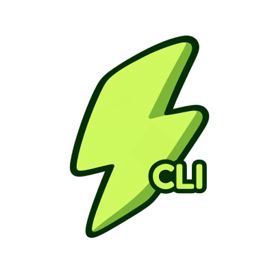

<p align="center">
  
</p>

# zap / zapwebp (CLI)

Fast, transparency-safe, reversible image conversion and optimization engine for developer terminals, CI/CD pipelines, and local workspaces. Powered by the shared `@zapwebp/core` engine.

Documentation: [https://zapwebp.vercel.app/cli](https://zapwebp.vercel.app/cli)

---

## Installation & Execution

Run directly without installation via `npx` (using either `zap` or `zapwebp`), or install globally:

```bash
# Direct run via npx (short or canonical alias)
npx zap logo.svg --to webp
npx zapwebp logo.svg --to webp

# Global install
npm install -g zapwebp
pnpm add -g zapwebp
```

Both `zap` and `zapwebp` executables are included and behave identically.

---

## Quick Starts

```bash
# 1. Single conversion with transparency preservation
zap logo.svg -o logo.webp

# 2. Multi-target conversion (writes logo.webp, logo.avif, logo.png)
zap logo.svg --to webp,avif,png

# 3. Responsive scale multipliers (@1x, @2x, @3x) with manifest.json
zap icon.png --scale 1,2,3 --out-dir dist/icons

# 4. Bundle batch conversion into an in-memory ZIP archive
zap "src/assets/**/*.{svg,png}" --to webp --scale 1,2 --zip -o bundle.zip

# 5. Generate ready-to-paste  HTML markup
zap banner.png --scale 1,2,3 --srcset

# 6. Git-aware: convert only files modified vs HEAD or currently staged
zap --changed --to webp
zap --staged --to webp

# 7. Clean Mode: strip AI provenance and C2PA metadata with certificate check
zap photo.png --clean --verify-clean

# 8. Standard stdin to stdout streaming
cat icon.svg | zap - --to webp > icon.webp
```

---

## Subcommands Reference

### Workspace & Setup
| Subcommand | Description | Example |
|---|---|---|
| `init` | Scaffolds `.zapwebpignore` and `.zapwebp.config.json` with `.gitignore` integration | `zap init` |
| `doctor` | Runs health diagnostics on Node runtime, libvips, and workspace configuration | `zap doctor` |
| `config show` | Prints resolved configuration settings and origin precedence | `zap config show` |
| `gitignore <show\|add\|remove>` | Inspects or manages automated Zap marker blocks in `.gitignore` | `zap gitignore add` |

### Safety & Reversible Journaling
| Subcommand | Description | Example |
|---|---|---|
| `history` | Lists recorded conversion transactions from `.zapwebp/journal/` | `zap history` |
| `show <id>` | Shows detailed before/after file manifest and byte diffs for a transaction | `zap show 1740956200000` |
| `undo [id]` | Reverts the last conversion run (or specific transaction ID) byte-for-byte | `zap undo` |
| `redo [id]` | Re-applies an undone transaction | `zap redo` |
| `gc` | Prunes journal transactions older than retention limit (default 30 days) | `zap gc` |

### Diagnostics & Inspection
| Subcommand | Description | Example |
|---|---|---|
| `inspect <file>` | Prints image dimensions, channels, format, and alpha status in terminal | `zap inspect logo.png` |
| `audit <command>` | Lints shell conversion commands (e.g. `magick`) and recommends safe Zap syntax | `zap audit "magick logo.svg logo.jpg"` |
| `explain <file>` | Explains why a file would or would not be converted under the 10-Gate chain | `zap explain icon.svg` |
| `explain-black-bg` | Provides root-cause diagnosis and remedy for WebP black backgrounds | `zap explain-black-bg` |
| `ignored [dir]` | Lists all files excluded under the 3-layer ignore hierarchy | `zap ignored ./assets` |
| `watch [paths]` | Continuously watches target directories and re-converts on file changes | `zap watch src/images` |
| `check [paths]` | CI/CD gatekeeper; exits with code 1 if outputs are missing or outdated | `zap check src/images` |

---

## Options & Flags Reference

| Flag | Shorthand | Type | Default | Description |
|---|---|---|---|---|
| `--to` | `-t` | `string` | `webp` | Target format(s), comma-separated: `webp`, `png`, `jpeg`, `avif` |
| `--out` | `-o` | `string` | — | Explicit output path or ZIP filename |
| `--out-dir` | `-d` | `string` | — | Output directory for batch conversions |
| `--scale` | | `string` | `1` | Multiplier scale factors, e.g. `1,2,3` or `1x,2x` |
| `--base-width` | | `number` | source | Base pixel width for multiplier scaling |
| `--width` | `-w` | `number` | — | Fixed resize width in pixels |
| `--height` | `-h` | `number` | — | Fixed resize height in pixels |
| `--fit` | | `string` | `contain` | Resize strategy: `contain`, `cover`, `fill`, `inside`, `outside` |
| `--quality` | `-q` | `number` | `85` | Compression quality rating (1–100) |
| `--lossless` | | `boolean` | `false` | Enable lossless compression (WebP, AVIF, PNG) |
| `--background` | | `string` | — | Hex background color (required for transparent inputs to JPEG) |
| `--zip` | | `boolean` | `false` | Bundle converted batch outputs into a single in-memory ZIP |
| `--srcset` | | `boolean` | `false` | Output ready-to-paste `` HTML snippet |
| `--clean` | | `boolean` | `true` | Strip EXIF, XMP, C2PA, and software attribution markers |
| `--verify-clean` | | `boolean` | `false` | Asserts output has 0 metadata chunks and verifies certificate |
| `--changed` | | `boolean` | `false` | Convert only files modified relative to Git `HEAD` |
| `--staged` | | `boolean` | `false` | Convert only Git staged files |
| `--force-undo` | | `boolean` | `false` | Force undo even if files were modified after conversion |
| `--dry-run` | | `boolean` | `false` | Simulate conversion and report actions without writing files |
| `--json` | | `boolean` | `false` | Format terminal output as machine-readable JSON |
| `--config` | `-c` | `string` | — | Path to custom `zapwebp.config.json` |

---

## The 10-Gate File Selection Chain

Every candidate input file passes through 10 safety gates before conversion:

1. `not_found`: File must exist on disk.
2. `ignored`: File must not be excluded by built-ins, `.zapwebpignore`, or config.
3. `internal_artifact`: Skips `.zapwebp/` transaction journals and manifests.
4. `unsupported_format`: Verifies input magic bytes match supported formats.
5. `unsafe_svg`: Rejects SVGs containing active scripts, event handlers, or XXE entities.
6. `too_large`: Checks file size against maximum byte limits.
7. `symlink`: Rejects insecure or cyclical symlinks.
8. `outside_root`: Prohibits directory traversal above the workspace root.
9. `changed_during_run`: TOCTOU guard checking source hash before write.
10. `up_to_date`: Skips conversion if target output exists and is newer than source.

Use `zap explain <file>` to view the exact gate evaluation for any path.

---

## Configuration File (`zapwebp.config.json`)

Configure team-wide defaults in your project root:

```json
{
  "$schema": "https://zapwebp.vercel.app/schema.json",
  "to": ["webp", "avif"],
  "quality": 85,
  "scales": [1, 2],
  "clean": true,
  "outDir": "public/dist",
  "ignore": ["node_modules/**", "test/fixtures/**"]
}
```

---

## Exit Codes

| Code | Meaning |
|---|---|
| `0` | Success: all files converted or verified cleanly |
| `1` | Conversion failure, check failure, or unsafe SVG input |
| `2` | Invalid CLI arguments or unrecognized subcommand |

---

## License

MIT © [Zapwebp](https://zapwebp.vercel.app/)
