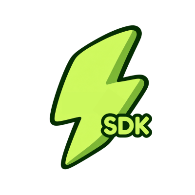

<p align="center">
  
</p>

# @zapwebp/plugin-sdk

Plugin SDK and lifecycle contracts for extending Zap conversion workflows, adapters, and asset pipelines. Enables developers ("Zap Devs") to hook into before/after conversion events, create custom storage adapters (S3, Cloudflare R2, memory), and build framework integrations (Next.js, Vite, Astro).

Documentation: [https://zapwebp.vercel.app/docs](https://zapwebp.vercel.app/docs)

---

## Features

- **Lifecycle Event Hooks:** Intercept and modify options in `beforeConvert` and process generated buffers in `afterConvert`.
- **Pluggable Storage Adapters:** Standardized `StorageAdapter` interface (`write`, `read`, `delete`, `exists`) for cloud and custom file backends.
- **Contract Immutability:** Enforces strict shape validation and immutability via `definePlugin()`.
- **Zero Overhead:** Plugin manager executes hooks with minimal latency and preserves core in-memory guarantees.

---

## Installation

```bash
pnpm add @zapwebp/plugin-sdk
```

---

## Creating a Plugin

Use `definePlugin()` to author a type-safe plugin:

```typescript
import { definePlugin } from '@zapwebp/plugin-sdk';

export const myVitePlugin = definePlugin({
  name: 'zap-plugin-vite',
  version: '1.0.0',
  description: 'Vite asset transform plugin for Zap',
  hooks: {
    beforeConvert(ctx) {
      console.log('Converting image with options:', ctx.options);
      // Optionally mutate or normalize options before conversion
    },
    afterConvert(ctx, outputs) {
      console.log(`Generated ${outputs.length} asset outputs`);
      // Perform post-processing, logging, or watermarking
    },
  },
  adapters: {
    memory: {
      async write(dest, data) {
        // Custom storage write logic
        return { path: dest, bytes: data.length };
      },
      async read(src) {
        // Custom storage read logic
        return Buffer.from('');
      },
      async delete(src) {
        return true;
      },
      async exists(src) {
        return true;
      },
    },
  },
});
```

---

## Using Plugins with the Plugin Manager

```typescript
import { PluginManager } from '@zapwebp/plugin-sdk';
import { myVitePlugin } from './my-vite-plugin';

const manager = new PluginManager();

// Register the plugin
manager.register(myVitePlugin);

// Execute lifecycle hooks
const context = { input: 'logo.svg', options: { to: 'webp' } };
await manager.executeBeforeConvert(context);

// Run core conversion...
const outputs = [{ format: 'webp', data: Buffer.from([]) }];

// Execute post-conversion hooks
await manager.executeAfterConvert(context, outputs);

// Retrieve custom storage adapter
const memoryAdapter = manager.getStorageAdapter('memory');
```

---

## Plugin Contract Specification

```typescript
export interface ZapPlugin {
  name: string;
  version: string;
  description?: string;
  hooks?: {
    beforeConvert?: (context: ConvertContext) => void | Promise<void>;
    afterConvert?: (context: ConvertContext, outputs: OutputAsset[]) => void | Promise<void>;
  };
  adapters?: Record<string, StorageAdapter>;
}

export interface StorageAdapter {
  write(destination: string, data: Buffer): Promise<{ path: string; bytes: number }>;
  read(source: string): Promise<Buffer>;
  delete(source: string): Promise<boolean>;
  exists(source: string): Promise<boolean>;
}
```

---

## License

MIT © [Zapwebp](https://zapwebp.vercel.app/)
